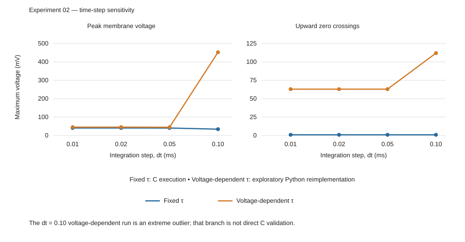
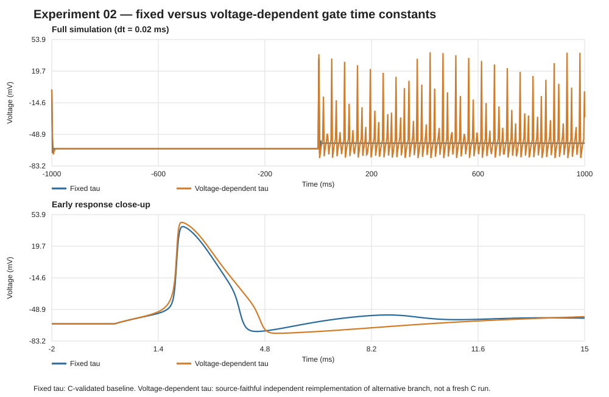

# Experiment 02 — Fixed versus voltage-dependent gating time constants

**Classification:** New retrospective experiment (2026); not presented as part of the 2015 work.  
**Status:** The fixed-time-constant results are C-validated; the voltage-dependent results remain exploratory Python reimplementation results.

## Aim

Test the effect of using the fixed gating time constants in the original implementation versus using the voltage-dependent `ttaui` values recalculated inside `derivs()`.

The user has clarified that the intended `tau_m`, `tau_h`, and `tau_n` were fixed. Therefore, the original fixed-time-constant implementation remains the reference. The voltage-dependent version is a counterfactual sensitivity test, not a proposed correction to the 2015 model.

## What changed

Both variants use the same equations, parameters, initial state, stimulus and RK4 method. The comparison changes only the denominators in the three gating-variable derivatives:

- **Fixed variant:** divides by `taui[0..2]`, calculated once in `main()` at the initial membrane voltage.
- **Voltage-dependent variant:** divides by `ttaui[0..2]`, recalculated from the membrane voltage each time `derivs()` is evaluated, including the intermediate RK4 evaluations.

For the finer time steps, the loop and delay indices were changed from `short` to `int` in the experimental copies. This avoids integer overflow in the delay index at `dt = 0.01` (the original `short` cannot represent the required index of 50,000). This type change does not alter the model equations.

## Reproduction

The complete experimental C++ sources are included in this folder:

- [Fixed time constants](fixed/HH1neuron.cpp) — original fixed-time-constant equations, with the time-step/index settings adjusted for this comparison.
- [Voltage-dependent time constants](voltage_dependent/HH1neuron.cpp) — the same experimental source, with only the three gating derivative denominators changed from `taui` to `ttaui`.

Both copies retain the original parameter values, initial conditions, stimulus logic, delayed-voltage remnant and output convention. The experimental copies use `int` rather than `short` for the loop and delay indices so the finer-step runs can represent their larger index values. They also use a standard `int main(void)` declaration and check whether the output file opened successfully; these are portability/safety adjustments, not changes to the model.

Compile and run each variant from its own folder (both programs write `HH1neuron.dat` to the current working directory):

```sh
cd fixed
gcc -x c -std=gnu89 -O0 HH1neuron.cpp -lm -o HH1neuron
./HH1neuron
cd ../voltage_dependent
gcc -x c -std=gnu89 -O0 HH1neuron.cpp -lm -o HH1neuron
./HH1neuron
```

The fixed-time-constant values are C-validated against Experiment 03. The voltage-dependent values in the table come from an exploratory Python reimplementation and have not yet been reproduced by executing the committed voltage-dependent C source.

## Results

The fixed-time-constant comparison was run in C at the listed step sizes. The voltage-dependent comparison at the listed step sizes was generated by the exploratory Python reimplementation.

| Variant | dt | Maximum voltage | Minimum voltage | Final voltage | Upward zero crossings |
| --- | ---: | ---: | ---: | ---: | ---: |
| Fixed | 0.10 | 34.4322 | −72.7499 | −59.2686 | 1 |
| Fixed | 0.05 | 40.7996 | −72.7820 | −58.8729 | 1 |
| Fixed | 0.02 | 40.9218 | −72.7821 | −58.6296 | 1 |
| Fixed | 0.01 | 40.9242 | −72.7823 | −58.5473 | 1 |
| Voltage-dependent | 0.10 | 452.6870 | −74.7720 | −62.3716 | 112 |
| Voltage-dependent | 0.05 | 45.0183 | −74.7748 | −29.9937 | 63 |
| Voltage-dependent | 0.02 | 45.5119 | −74.7753 | −30.3730 | 63 |
| Voltage-dependent | 0.01 | 45.5205 | −74.7753 | −30.3839 | 63 |

The exploratory Python runs produced finite output values. At `dt = 0.1`, the voltage-dependent variant exhibits an extreme voltage excursion (approximately 453) and many additional zero crossings. This is strong evidence that this step size is too coarse for that alternative implementation. At `dt = 0.05`, `0.02`, and `0.01`, the Python reimplementation instead produced approximately 63 upward zero crossings. The peak voltage and final voltage were close between the 0.02 and 0.01 runs. These observations are provisional until the C++ alternative is run and checked.

The fixed-time-constant runs do not show sustained repetitive action potentials. Their maximum voltage converges from approximately 40.80 at `dt = 0.05` to 40.92 at `dt = 0.02` and 40.92 at `dt = 0.01`. The single upward crossing is consistent with the initial spike seen in Experiment 01.

The summary values are also provided in [`summary.csv`](summary.csv).



The figure compares peak voltage and upward zero-crossing counts across the tested integration steps. It deliberately labels the fixed-time-constant series as C execution and the voltage-dependent series as an exploratory Python reimplementation; the latter has not yet been validated by compiling the committed alternative C source.

## Membrane-potential plots



The full trace and early-response close-up compare the two time-constant interpretations at dt = 0.02 ms. The fixed-time-constant trace has the single spike seen in the baseline. The voltage-dependent alternative produces repeated excursions, so the difference is not merely a small change in spike height or timing: it changes the qualitative firing pattern. This is a counterfactual sensitivity result, not a correction to the intended model.

The fixed-time-constant trace is based on the C-validated fixed implementation. The voltage-dependent curve is generated by a source-faithful Python reproduction of the alternative C branch and remains exploratory pending direct C validation. The plot is labelled accordingly.

## Interpretation

The exploratory Python comparison suggests that using the recalculated voltage-dependent time constants could substantially change the simulated behaviour. It also demonstrates that the coarse `dt = 0.1` step is inadequate for that alternative formulation.

However, because the intended model uses fixed time constants, the different repetitive-firing behaviour is **not evidence that the original code is wrong**. The `ttaui` calculations inside `derivs()` are redundant under the clarified model specification. They can be removed in a future clean-up variant, but the original 2015 source is left unchanged.

## Scope and limitations

- The comparison is a retrospective computational investigation, not a reconstruction of a documented 2015 experiment.
- The experimental copies retain the original stimulus handling and output time-label convention; those issues are investigated separately.
- The model units are confirmed as mV for voltage, ms for time, µF/cm² for capacitance, mA/cm² for membrane current density, nA for injected current, mS/cm² for conductance density, and dimensionless for gating variables. Rate constants use ms⁻¹.
- No claim is made that the voltage-dependent alternative is physiologically preferable. It is included to quantify the consequences of that implementation choice.

## Conclusion

The original fixed-time-constant interpretation is consistent with the intended model as clarified by the user. The recalculated `ttaui` arrays are unnecessary for that formulation. The counterfactual voltage-dependent implementation produces markedly different firing behaviour and requires a smaller integration step for stable results.

**Validation status:** The fixed-time-constant results are directly validated by C execution. All voltage-dependent results remain exploratory Python results pending direct C execution.
