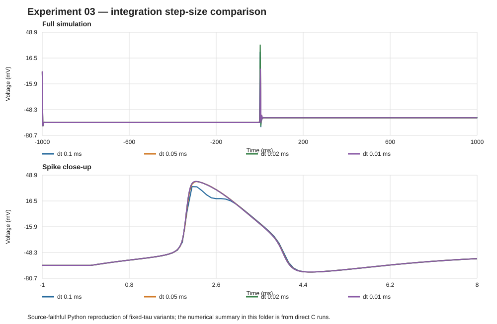

# Experiment 03 — Integration step-size comparison

**Classification:** New retrospective experiment (2026); not part of the documented 2015 work.  
**Status:** Fixed-time-constant C implementation compiled and run at four step sizes.

## Aim

Assess how the integration step size affects the numerical output of the original single-neuron model, using the intended fixed gating time constants and otherwise retaining the original parameter values, initial conditions, stimulus logic and RK4 method.

## Method

The comparison uses the fixed-time-constant experimental source from [Experiment 02](../02_time_constant_comparison/fixed/HH1neuron.cpp). The only model-setting change between runs is the number of time intervals `n`, which determines `tstep = 1000/n`.

| n | Integration step |
|---:|---:|
| 10,000 | 0.10 |
| 20,000 | 0.05 |
| 50,000 | 0.02 |
| 100,000 | 0.01 |

The source copies use `int` for the loop and delay indices rather than the original `short` declarations. This is necessary for the finer runs: the original `short` type cannot represent the loop index range required when `n = 50,000` or `100,000`. The experimental copy also uses a standard `int main(void)` declaration and checks that the output file opens. These are portability and robustness adjustments, not changes to the differential equations.

All four variants were compiled and executed as C using GCC:

```sh
gcc -x c -std=gnu89 -O0 HH1neuron.cpp -lm -o HH1neuron
./HH1neuron
```

A reproducible automation script is provided as [`run_experiment.py`](run_experiment.py). It compiles the source separately for each step size, runs each executable in its own output folder, calculates summary statistics and optionally generates plots (requires Matplotlib).

## Results

The following values were measured directly from the output files generated by the C implementation.

| Step | Rows | Minimum voltage | Time of minimum | Maximum voltage | Time of maximum | Final voltage |
|---:|---:|---:|---:|---:|---:|---:|
| 0.10 | 20,001 | −72.749909 | 4.60 | 34.432211 | 2.10 | −59.268612 |
| 0.05 | 40,001 | −72.782041 | 4.55 | 40.799568 | 2.20 | −58.872862 |
| 0.02 | 100,001 | −72.782122 | 4.54 | 40.921776 | 2.18 | −58.629568 |
| 0.01 | 200,001 | −72.782269 | 4.54 | 40.924245 | 2.18 | −58.547263 |

The upward and downward zero crossings are:

| Step | Upward crossing | Downward crossing |
|---:|---:|---:|
| 0.10 | 2.00 | 3.30 |
| 0.05 | 2.00 | 3.30 |
| 0.02 | 1.98 | 3.28 |
| 0.01 | 1.98 | 3.27 |

The summary table is also stored in [`summary.csv`](summary.csv).

## Interpretation

The coarsest step, 0.10, gives a noticeably lower peak voltage (34.43) than the finer runs (approximately 40.92). Reducing the step from 0.05 to 0.02 changes the peak from 40.80 to 40.92; reducing it again to 0.01 changes the peak by only about 0.0025. The minimum voltage and the times of the extrema also become very similar at 0.02 and 0.01.

The spike's detailed rising and falling waveform remains somewhat sensitive to step size: comparing the 0.02 and 0.01 output samples shows the largest differences around the rapid initial spike, rather than during the later steady plateau. Thus, convergence of a few scalar summary measures should not be mistaken for pointwise identity of the entire transient.

All four runs show one upward crossing and one downward crossing of zero voltage. The model does not develop sustained repetitive firing under the original fixed-time-constant settings.

## Membrane-potential plots



The full traces are very similar because all four runs produce the same broad response: one stimulus-evoked spike followed by recovery. The close-up around the spike reveals the important difference. The dt = 0.1 ms run underestimates the peak and gives a visibly coarser waveform; the 0.05 ms, 0.02 ms and 0.01 ms traces are progressively closer, with the two finest traces almost overlapping.

These curves are generated by a independent source-faithful reimplementation of the four fixed-time-constant variants. The numerical summary in this experiment was obtained directly from the C runs; the plotted curves are clearly distinguished as the Python reproduction.

## Important implementation notes

- The original source writes the state after an RK4 step but labels it with the step's starting time `tt`. The time labels in the tables therefore retain the original one-step offset; this experiment does not silently correct it.
- The stimulus transition handling is also retained unchanged. Its effect is investigated separately in the stimulus-boundary experiment.
- The original source's `short` loop index is adequate at `n = 10,000` and `20,000`, but not at `n = 50,000` or `100,000`. The experimental variants use `int` to make those runs valid.
- Units are confirmed: time and integration step in ms; voltage in mV; capacitance in µF/cm²; membrane current density in mA/cm²; injected current in nA; conductance density in mS/cm²; and gating variables dimensionless.

## Conclusion

For this model and parameter set, `dt = 0.1` is too coarse to reproduce the peak of the action-potential-like transient accurately. The peak voltage and other summary measures are very similar at `dt = 0.02` and `dt = 0.01`, suggesting that 0.02 is a reasonable efficiency/accuracy compromise for subsequent exploratory work. The 0.01 run provides a finer reference where transient detail is important.

This is a numerical sensitivity assessment of the original fixed-time-constant model, not a claim that the 2015 simulation used these alternative step sizes.
