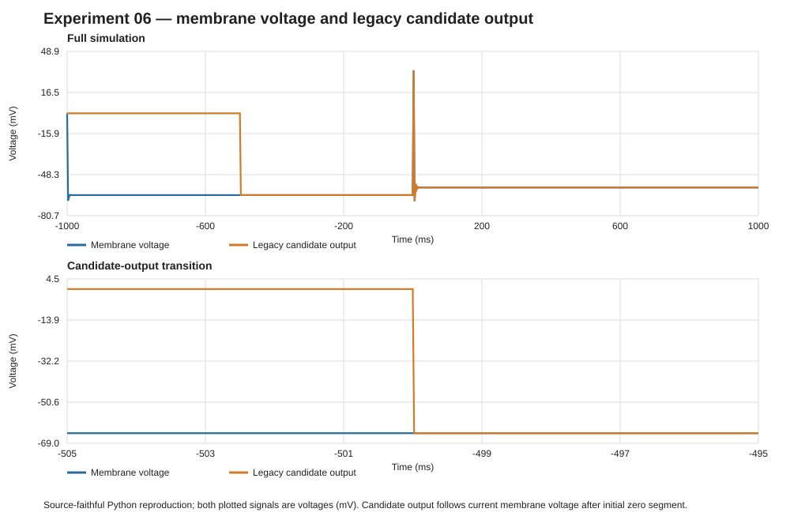

# Experiment 06 — Delayed neuronal output and the vagus nerve

**Classification:** Retrospective investigation (2026), based on the author's recollection of the intended 2015 project.  
**Status:** Compiled and executed locally as C; the output comparison confirms the source-level finding below.

## Aim

Investigate the legacy delayed-voltage calculation in the single-neuron model, in light of the author's recollection that this neuron was intended to provide an output signal to the vagus nerve.

The working historical interpretation is a one-way output from the modelled neuron towards the vagus nerve. The vagus nerve, its receiving dynamics, any cardiac response, and heartbeat/respiratory-arrhythmia coupling are not modelled in this experiment. The exact physiological meaning and intended downstream interpretation of the signal remain unconfirmed and should be checked against project records or the former supervisor if possible. The membrane-voltage and time units used by the model are confirmed as mV and ms.

## What the source does

The original source sets `tau = 500` and calculates `yy0old` from `y0top`, `y0bot`, and the loop indices. The comment describes this as calculating membrane voltage at `tt - tau`.

However, inspection of the indexing and interpolation expression shows that, after the delayed index becomes positive, the expression algebraically returns `y0top`, which has just been assigned the current `y[0]`. Before that point, both stored values are set to zero and `yy0old` is zero. In other words, in this implementation the candidate output is zero initially and then follows the current membrane voltage; it does not demonstrably provide a 500-time-unit delayed copy.

This is confirmed by executing the experimental C source with the original model settings (`dt = 0.02`, 50,000 intervals in each direction). The program produced 100,001 rows. The candidate output was zero for the first 25,001 rows; on every subsequent row, `yy0old` matched the current `y[0]` exactly at the six-decimal output precision (maximum absolute difference: 0.000000 in the recorded file). For example, the first non-zero candidate output occurs at `t = -499.98`, where both voltage columns are `-64.473038`; at the final row (`t = 1000`), both are `-58.464283`. Thus the candidate output is not a 500-time-unit delayed trace: it is zero initially and then follows the current membrane voltage. This is a finding about the implementation, not a claim about what the author originally intended. The original calculation is retained so its behaviour can be inspected rather than silently replaced with a newly invented delay implementation.

## Experimental source

[`HH1neuron_vagus_output.cpp`](HH1neuron_vagus_output.cpp) is based on the fixed-time-constant source used for Experiment 05. It:

- preserves the four-state-variable neuron, its equations, parameters, initial conditions, stimulus, and RK4 integration;
- retains the legacy calculation of `yy0old`;
- writes four tab-separated columns: loop time, applied current, current membrane voltage before the integration step, and the legacy candidate output `yy0old`;
- uses integer loop/index types, consistent with the later retrospective experiment files.

The two voltage columns are recorded at the same point in the loop, before the RK4 step, so they can be compared directly. This changes the output sampling convention relative to the original program, which wrote the voltage after the step while labelling it with the step-start time. It does not intentionally change the neuronal equations or integration.

Compile and run from a directory where the output file can be created:

```sh
gcc -x c -std=gnu89 -O0 HH1neuron_vagus_output.cpp -lm -o experiment06
./experiment06
```

The program writes `HH1neuron.dat`.

## Execution results\n\nThe source compiled successfully with `gcc -x c -std=gnu89 -O0 HH1neuron_vagus_output.cpp -lm` and ran successfully. The resulting file contained 100,001 rows and four columns. The comparison above was made between the third column (current membrane voltage) and fourth column (legacy candidate output).\n\n## Membrane-potential and candidate-output plots



The full trace shows the key result: the candidate output is zero during the initial part of the simulation, then follows the membrane-voltage trace rather than appearing as a voltage waveform delayed by 500 ms. The close-up around the transition makes the point at which the two traces begin to coincide easier to see.

Both curves are voltages, measured in mV. The candidate output is not a current and should not be interpreted as a separate vagus-nerve response. The plot is generated from a independent source-faithful reimplementation of the experimental C source; the numerical equality reported above was separately confirmed from the direct C output file.

## Interpretation and limitations

The executed comparison confirms that the two voltage columns match after the initial zero segment. The current implementation's candidate output is therefore not functioning as a delayed voltage signal. It would be inappropriate to describe it as a verified neuron-to-vagus transmission signal or to infer excitation versus inhibition from it.

A true delayed output would require retaining past voltage samples (or an equivalent delay-line/history mechanism) and retrieving the value corresponding to the chosen delay. That would be a separate reconstruction choice and is deliberately not introduced here because the historical implementation and intended timing have not been established.

No additional neuron is introduced. No vagus-nerve model, feedback pathway, gain, polarity, or cardiac model is added. The model uses mV for membrane voltage and ms for time; the candidate output is a voltage and therefore follows the membrane-voltage unit.

## Conclusion

Experiment 06 documents and exposes the legacy candidate output without changing the neuronal dynamics. The source suggests that the historical delay calculation does not currently implement the delay indicated by its comment. The likely one-way neuron-to-vagus purpose is recorded as the author's recollection, not as a verified physiological mechanism.
