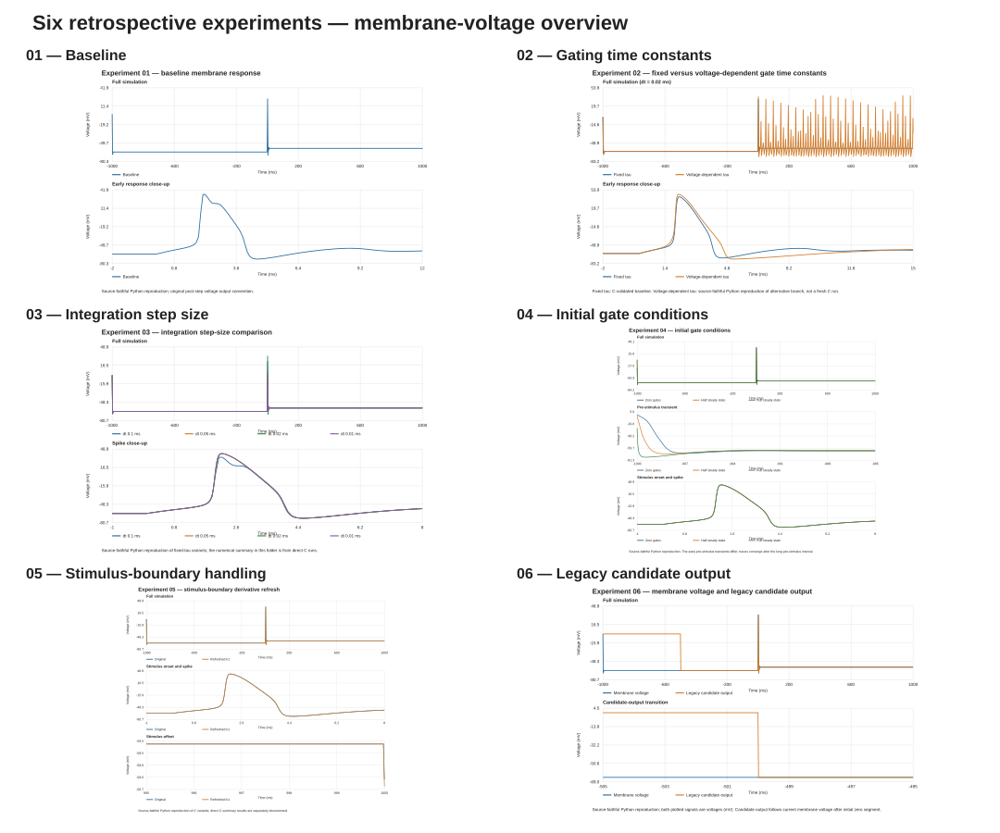

# Retrospective experiments — visual and technical guide

This folder contains six separate investigations of the preserved 2015 single-neuron membrane model. They were carried out retrospectively in 2026; they are not presented as experiments from the original project.

The plots below provide a visual overview of the membrane-potential behaviour investigated in each experiment. Each individual experiment README contains its own figure, parameter settings, numerical results, interpretation and limitations.

## Experiment guide

| Experiment | What is varied or inspected | What the voltage traces show |
|---|---|---|
| [01 — Baseline reproduction](01_baseline_reproduction/README.md) | Original source and original settings | The reference single-spike response and subsequent recovery. |
| [02 — Gating time constants](02_time_constant_comparison/README.md) | Fixed time constants versus a voltage-dependent alternative | The fixed version retains the baseline single spike; the alternative produces repeated excursions. The alternative remains exploratory and is not treated as the intended model. |
| [03 — Integration step size](03_integration_step_comparison/README.md) | Four integration steps: 0.10, 0.05, 0.02 and 0.01 ms | The coarsest step underestimates the spike peak; the finer traces converge more closely. |
| [04 — Initial gate conditions](04_initial_conditions/README.md) | Zero, half steady-state and full steady-state initial gate values | Early pre-stimulus transients differ, then converge before stimulation under the tested long pre-stimulus interval. |
| [05 — Stimulus-boundary handling](05_stimulus_boundary/README.md) | Original RK4 first-derivative handling versus refreshing k1 at stimulus transitions | The traces differ slightly around stimulus onset and offset but retain the same broad response. |
| [06 — Legacy candidate output](06_delayed_vagus_output/README.md) | Membrane voltage versus the legacy candidate delayed-voltage output | The candidate is initially zero and then follows current membrane voltage; it does not behave as a delayed copy in the tested source. |

## Experiment 07 — Phase-plane and equilibrium analysis

[Experiment 07](07_phase_plane_analysis/README.md) adds a mathematical analysis of the four-state model: gate nullclines, projected phase-plane trajectories, equilibria under constant input, and local stability from Jacobian eigenvalues. It includes a separate C++ trajectory exporter and a Python plotting/analysis script. The experiment README explains the equations, numerical root finding, nullcline construction and stability interpretation.

## How to read the plots

- All membrane-voltage axes use mV and all time axes use ms.
- Full-run panels show the broad behaviour over the full simulation window; close-ups reveal spike shape, early transients or stimulus-boundary effects.
- Where multiple variants are shown, the legend identifies the parameter or implementation choice.
- The figures are generated from independent source-faithful reimplementations of the corresponding loops. The individual READMEs explicitly distinguish these figures from numerical summaries obtained directly from C execution. In particular, the voltage-dependent alternative in Experiment 02 remains exploratory; the direct C validation status is not overstated.
- Experiment 06 plots two voltage quantities, not a membrane current and a voltage.

## Interpretation across experiments

The six investigations do not represent a sequence of six increasingly corrected neuron models. They ask different questions:

1. Establish what the original implementation produces.
2. Test the consequences of an alternative interpretation of the gate time constants.
3. Assess numerical sensitivity to the integration step.
4. Test sensitivity to initial gate values.
5. Examine consistency of the RK4 derivative at discontinuities in the applied stimulus.
6. Inspect whether the legacy interpolation actually implements the intended delayed-voltage behaviour.

The original source remains preserved at the repository root. The experiment-specific source copies and results are kept in their respective folders so that retrospective findings do not silently alter the historical implementation.
